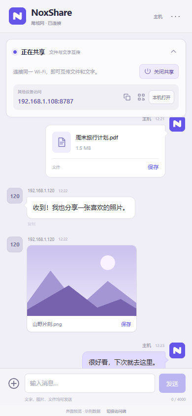
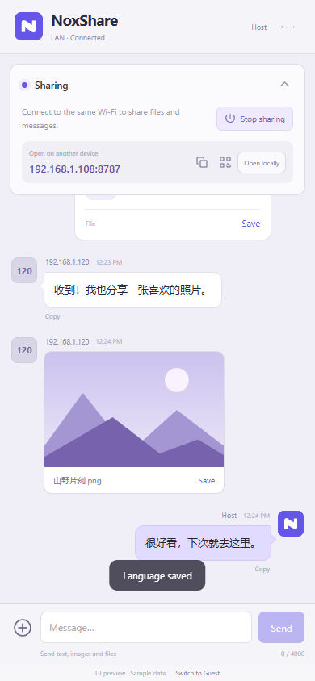

<p align="center"></p>

# NoxShare

**简体中文** · [English](README.md)

聊天式 Android 局域网共享工具，可互发文件、图片、视频和文字。其他设备使用浏览器即可加入。制作：**@NoxLeo**。

**当前版本 1.0.7 · Android 8.0 及以上 · 简体中文 / English**

[下载 APK](https://github.com/NoxLeo725/NoxShare/releases/download/v1.0.7/NoxShare-1.0.7.apk) · [更新说明](https://github.com/NoxLeo725/NoxShare/releases/tag/v1.0.7)

<p> </p>

## 功能

| 功能 | 说明 |
| --- | --- |
| 局域网网站 | 手机开启或关闭共享，其他设备打开简短的 IP 和端口地址，也可扫码连接。 |
| 双向传输 | 主机和访问端均可发送文件、图片、视频和文字，电脑网页支持拖拽上传。 |
| 聊天界面 | 顶部共享面板可收起；文件卡片包含时间和来源，手机标记为「主机」，访问端显示连接 IP。 |
| 图片、视频预览 | 单击图片放大查看，单击视频播放和拖动进度，可保存或下载原文件。 |
| 文件管理 | 支持搜索、已发送/已接收、多选、移除和 ZIP 打包下载，主机可在聊天页长按文件删除。 |
| 文字与链接 | 自动识别网址，长按可复制链接或整段文字。 |
| Android 功能 | 用默认应用打开文件、通过系统选择器保存，安装 APK 时按需引导授权。 |
| 共享设置 | 查看连接状态、IP、网关和服务自检，可选关闭共享后清理全部共享内容。 |
| 双语选择 | 默认跟随系统，设置中可选简体中文或 English，网页端可独立选择。 |

## 快速使用

1. 在 [Releases 下载 APK](https://github.com/NoxLeo725/NoxShare/releases/latest)，传到 Android 手机安装；也可按[构建说明](docs/BUILD.zh-CN.md)自行编译。
2. 手机和其他设备连接同一个 Wi-Fi，也可让其他设备连接手机热点。
3. 打开 NoxShare，在顶部面板点击「开启共享」。
4. 其他设备用浏览器打开显示的地址，例如 `http://192.168.1.108:8787`，或扫描二维码。
5. 底部输入文字发送，点击「＋」选择图片或文件；电脑可将文件拖入网页上传。
6. 在「… → 设置 → 语言」切换中英文，不再使用时点击「关闭共享」。

同一台手机访问时，点击「本机打开」，检查服务后会打开 `http://127.0.0.1:8787/`。其他设备使用主机显示的局域网 IP。

## 文档

- [使用说明 — 中文](docs/USAGE.zh-CN.md) / [User guide — English](docs/USAGE.en.md)
- [构建与测试 — 中文](docs/BUILD.zh-CN.md) / [Build and test — English](docs/BUILD.en.md)
- [第三方组件说明](THIRD_PARTY_NOTICES.md)

## 源码结构

```text
app/src/main/java/com/noxleo/share/   Android 界面、前台服务、HTTP 服务
app/src/main/assets/                 APP/网页共用界面和翻译资源
app/src/androidTest/                 独立 Android 功能测试
tests/                              JVM 服务测试和 Android 测试配置
tools/                              翻译资源生成工具
docs/                               双语说明及截图
```

开发环境为 Java 17、Android SDK 35、Gradle 8.10.2、Android Gradle Plugin 8.7.3。界面和二维码库均随应用打包，不依赖 CDN，默认共享端口为 **8787**。

浏览器传输、媒体播放、语言切换和核心服务测试已通过。Android 集成与通知语言切换已在 Android 15 模拟器检查；真实手机联网和厂商后台策略仍需设备验证。
